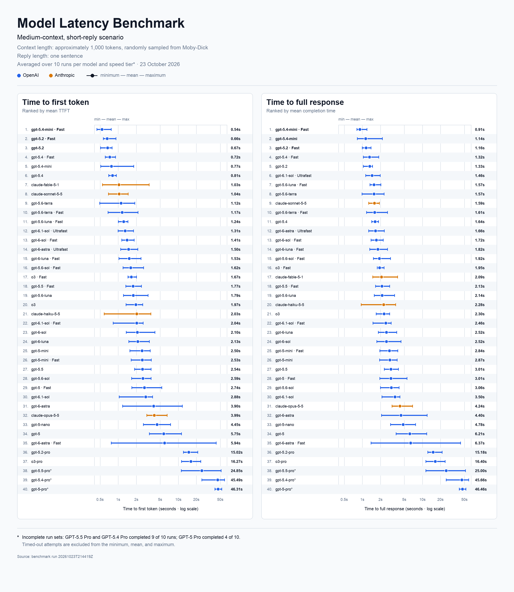

# OpenAI and Anthropic latency benchmark

This script compares OpenAI and Anthropic models with the same prompts and
streaming measurements. OpenAI models run across each supported Standard
(shown as **normal**), Fast, and Ultrafast mode. Anthropic models run in normal
mode using Standard capacity.

The benchmark records both:

- **TTFT:** request start to the first non-empty streamed output-text delta
- **Full latency:** request start through the completed streamed response

## Example benchmark results



## Benchmark Task

Each request asks the model to summarise a prose excerpt. The benchmark varies
two dimensions: context length and expected reply length. Contexts target
approximately 200, 1,000, or 5,000 tokens. Replies are either one sentence of
18 to 25 words summarising the main idea or event, or one paragraph of 100 to
130 words summarising the main events, ideas, or themes. The six combinations
form the selectable scenarios described below. Keeping the task consistent
isolates how context and expected response length affect latency.

By default, the script downloads the plain-text edition of [*Moby-Dick* from
Project Gutenberg](https://www.gutenberg.org/ebooks/2701) once when the script
starts. It removes Gutenberg's license header and footer, then selects a random
contiguous, paragraph-aligned excerpt for each run and context size.

The same excerpt is shared across every model, supported tier, and reply-length
variant within that run. This keeps comparisons fair while ensuring that repeated
runs do not send the same text. Sampling is reproducible: the same
`--seed`, corpus, run number, and context size produce the same excerpt.

Requests are sequential, and the combinations are shuffled within each round to
reduce ordering bias. By default, a unique value near the start of every prompt
prevents prompt-cache hits from skewing long-context measurements.

Paragraph boundaries mean actual lengths can be slightly above or below the
200, 1,000, and 5,000-token targets. Exact token counts, paragraph positions,
and excerpt hashes are recorded in `config.json` and `raw_results.csv`.

## Setup

```bash
cd openai-latency-benchmark
python3 -m venv .venv
source .venv/bin/activate
python -m pip install -r requirements.txt
export OPENAI_API_KEY="your-api-key"
export ANTHROPIC_API_KEY="your-api-key"
```

Only the key for a selected provider is required. An OpenAI-only invocation
does not require `ANTHROPIC_API_KEY`, and an Anthropic-only invocation does not
require `OPENAI_API_KEY`.

## Example run

Run the medium-context, short-reply summarisation scenario 100 times for each
supported speed tier of GPT-5.4 Mini:

```bash
python benchmark.py \
  --models gpt-5.4-mini \
  --scenarios medium_context_short_reply \
  --runs-per-test 100 \
  --timeout 60
```

## Select models

The built-in full set contains 33 text/reasoning models as of October 24, 2026:
27 OpenAI models and six Anthropic models. It includes active models and models
that are deprecated but not yet retired. Deprecated models remain available
through the API until their provider's shutdown date, allowing migration
comparisons.

See the complete built-in list without making an API request:

```bash
python benchmark.py --list-models
```

Benchmark the full range:

```bash
python benchmark.py --all-models --dry-run
python benchmark.py --all-models
```

Or select one provider's complete built-in catalog:

```bash
python benchmark.py --all-openai-models
python benchmark.py --all-anthropic-models
```

The built-in support matrix currently contains 50 valid model/tier pairs. The
full default run is therefore 50 pairs × 6 scenarios × 10 runs = 3,000 planned
generations, so review the dry run before spending API credits.

Benchmark only particular models when you do not want the full run:

```bash
python benchmark.py \
  --models gpt-6-luna gpt-5-mini claude-sonnet-5-5 \
  --runs-per-test 2
```

Exactly one model-selection or inspection option must be supplied: `--models`,
`--all-models`, `--all-openai-models`, `--all-anthropic-models`,
`--list-models`, `--list-model-tiers`, `--list-scenarios`, or `--show-prompt`.

Inspect the internal support matrix without making an API request:

```bash
python benchmark.py --list-model-tiers
```

[Ultrafast mode](https://developers.openai.com/api/docs/guides/ultrafast-mode)
currently supports GPT-6 Astra and GPT-6.1 Sol. [Fast
mode](https://developers.openai.com/api/docs/guides/fast-mode) is selected with
`service_tier="fast"`. The script stores a dated internal support matrix based
on [OpenAI's pricing tables](https://developers.openai.com/api/docs/pricing) and
removes unsupported model/tier pairs before any API calls are made. A custom
model ID not in the table is conservatively treated as normal-only. Custom IDs
beginning with `claude-` use Anthropic; other custom IDs use OpenAI. Runtime
tier-rejection handling remains as a fallback for account or project restrictions.

[Anthropic's Priority Tier](https://platform.claude.com/docs/en/api/service-tiers)
is a contracted capacity/availability tier rather than an OpenAI Fast-mode
equivalent. The benchmark therefore sends Claude normal-mode requests with
`service_tier="standard_only"`. Fast and Ultrafast Claude jobs are not created.

### Maintain the built-in `--all-models` catalog

The permanent catalogs are near the top of `benchmark.py`:

- Add an active OpenAI ID to `OPENAI_CURRENT_TEXT_MODELS`, or a callable
  deprecated OpenAI ID to `OPENAI_DEPRECATED_TEXT_MODELS`.
- Add an active Anthropic ID to `ANTHROPIC_CURRENT_TEXT_MODELS`, or a callable
  deprecated Anthropic ID to `ANTHROPIC_DEPRECATED_TEXT_MODELS`.
- Add the same ID to `MODEL_TIER_SUPPORT`. Use `("normal",)` unless the
  provider's current documentation explicitly confirms Fast or Ultrafast
  support; this prevents `--all-models` from making known-invalid tier calls.
- When a deprecated model reaches its provider's retirement date, remove it
  from `OPENAI_DEPRECATED_TEXT_MODELS` or
  `ANTHROPIC_DEPRECATED_TEXT_MODELS`, and remove its entry from
  `MODEL_TIER_SUPPORT`. Otherwise, `--all-models` will continue scheduling
  requests that the provider rejects, producing failed cells and a non-zero
  exit status.
- Update `MODEL_CATALOG_AS_OF` and `MODEL_TIER_SUPPORT_AS_OF` after checking the
  provider documentation.

Then verify the catalog without making API requests:

```bash
python benchmark.py --list-models
python benchmark.py --list-model-tiers
python benchmark.py --all-models --dry-run
```

For a one-off test, no catalog edit is required. Pass the model ID to
`--models`; IDs not present in `MODEL_TIER_SUPPORT` are treated as normal-only.
Names beginning with `claude-` use Anthropic, while other custom IDs use
OpenAI.

## Select scenarios

For every supported model/tier pair, the benchmark offers six scenarios:

- `short_context_short_reply`: ~200-token context, one-sentence reply
- `short_context_medium_reply`: ~200-token context, one-paragraph reply
- `medium_context_short_reply`: ~1,000-token context, one-sentence reply
- `medium_context_medium_reply`: ~1,000-token context, one-paragraph reply
- `long_context_short_reply`: ~5,000-token context, one-sentence reply
- `long_context_medium_reply`: ~5,000-token context, one-paragraph reply

List the six selectable scenario names:

```bash
python benchmark.py --list-scenarios
```

Run one scenario for selected models:

```bash
python benchmark.py \
  --models gpt-6-astra gpt-5-mini \
  --scenarios short_context_short_reply
```

Run several scenarios:

```bash
python benchmark.py \
  --models gpt-6-astra gpt-6.1-sol \
  --scenarios \
    short_context_short_reply \
    medium_context_medium_reply \
    long_context_short_reply
```

If `--scenarios` is omitted, all six run. You can also restrict processing
modes independently, for example `--tiers normal fast`.

Generate the exact run-1 prompt for a scenario without making an API request.
The excerpt is selected using `--seed`:

```bash
python benchmark.py --show-prompt medium_context_short_reply --seed 123
```

## Select repetitions

`--runs-per-test` sets the number of generations for every selected
model/tier/scenario combination. Each combination targets ten valid generations
by default. The shorter `--runs` name remains as an alias.

```bash
python benchmark.py \
  --models gpt-6-astra gpt-6.1-sol \
  --scenarios medium_context_short_reply \
  --runs-per-test 25
```

Useful options:

- `--reasoning-effort low` fixes OpenAI reasoning effort; Anthropic models use
  their API default.
- `--runs-per-test 25` sets repetitions per selected model/tier/scenario test.
- `--seed 123` makes randomized context selection and job ordering reproducible.
- `--corpus-file PATH` uses a local UTF-8 book or other long-form text.
- `--corpus-url URL` downloads a different online plain-text corpus.
- `--allow-cache` intentionally measures repeated prompts with prompt caching allowed.
- `--output-dir PATH` selects the result directory.
- `--max-attempts N` controls retries for transient errors or tier downgrades.
- `--timeout SECONDS` sets a hard wall-clock deadline for each complete streamed
  attempt (default: 120). A timeout is recorded and retried up to
  `--max-attempts`.
- `--pause SECONDS` controls pacing between calls.

Use another online plain-text corpus with `--corpus-url`:

```bash
python benchmark.py \
  --models gpt-6-astra \
  --corpus-url https://example.com/book.txt
```

Or avoid the corpus download by supplying a local UTF-8 text file containing at
least 20 blank-line-separated paragraphs:

```bash
python benchmark.py \
  --models gpt-6-astra \
  --corpus-file /absolute/path/to/book.txt
```

A 60-second timeout is intentionally aggressive for the full catalog. OpenAI
notes that [GPT-5.4 Pro](https://developers.openai.com/api/docs/models/gpt-5.4-pro)
and [GPT-5 Pro](https://developers.openai.com/api/docs/models/gpt-5-pro) requests
may take several minutes. Use `--timeout 300` or higher when benchmarking Pro
models, or select non-Pro models when a one-minute ceiling is part of the test.

## Outputs

Every run creates a timestamped directory under `benchmark-results/` containing:

- `config.json`: exact providers, models, tiers, timeout/retry settings, corpus
  identity and hash, sampled paragraph ranges, scenario sizes, and run settings
- `raw_results.csv`: every attempted request plus runtime unavailable-tier
  skips, context hashes and ranges, errors, and tier mismatches; preflight
  exclusions are in `config.json`
- `summary.csv`: mean, median, and p95 TTFT/full latency for each valid cell
- `aggregate.csv`: min, mean, and max TTFT/full latency by model and tier, with
  each scenario aggregated separately
- `summary.md`: scenario detail plus separate aggregate tables for each scenario

The same scenario-separated aggregate tables are printed in the terminal when
the run finishes.

The response's actual service tier is recorded. For OpenAI, a Fast response
reported as `priority` is valid because those names are API aliases. For
Anthropic, a normal request must report Standard. Any mismatch is excluded from
the averages and retried up to `--max-attempts` times.

The benchmark uses ordinary HTTP response streaming for all tiers so transport
is held constant. TTFT means the first non-empty visible text delta for either
provider. OpenAI recommends a persistent WebSocket connection for
latency-sensitive, multi-turn Ultrafast workloads; this script intentionally
measures single requests instead.
